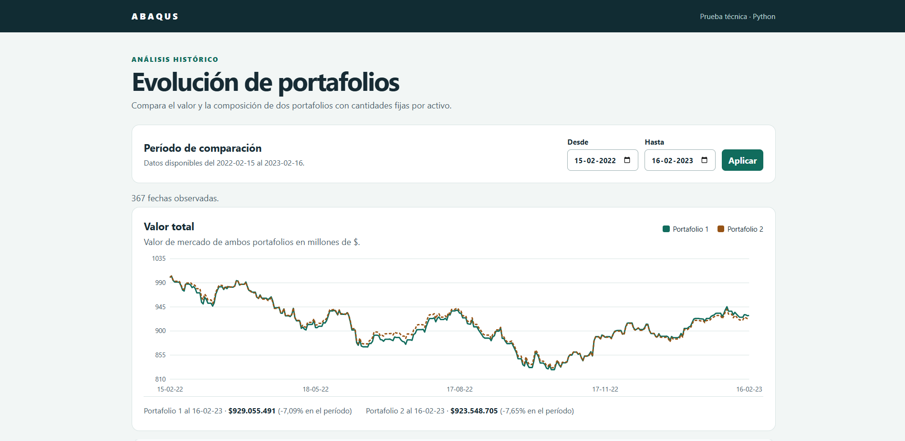
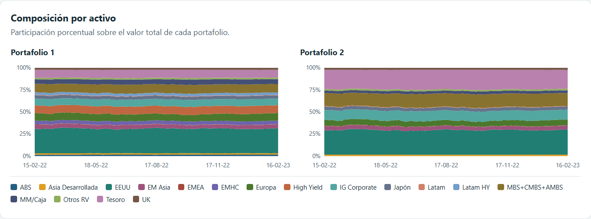
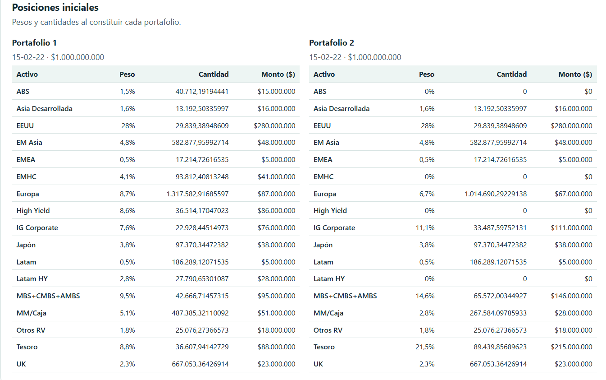

# Comparador de portafolios



Aplicación web desarrollada como prueba técnica para comparar dos portafolios de inversión a partir de sus pesos iniciales y precios históricos.

## Problema y propósito

El archivo `datos.xlsx` contiene la composición inicial de dos portafolios y los precios históricos de sus activos. El objetivo es calcular cómo habría evolucionado el valor de cada uno en el tiempo, manteniendo fija la cantidad comprada de cada activo en la fecha inicial.

Esto significa que los portafolios no se rebalancean: sus valores totales y pesos relativos cambian según los precios observados.

## Solución

La aplicación usa Django y SQLite. Importa y valida las hojas `weights` y `Precios`, relaciona los datos por nombre de activo y persiste la carga en una transacción para evitar actualizaciones parciales. Las cantidades iniciales se derivan del capital, el peso y el precio de origen; las valoraciones históricas se calculan bajo demanda usando `Decimal` para conservar precisión.

El panel permite seleccionar un rango de fechas y consultar el valor total, la composición por activo y las posiciones iniciales. La misma información está disponible mediante endpoints JSON.

## Estructura del proyecto

| Ruta | Responsabilidad |
| --- | --- |
| `config/` | Configuración de Django, SQLite y enrutamiento principal. |
| `portfolios/models.py` y `migrations/` | Modelos, relaciones y restricciones de activos, portafolios, posiciones y precios. |
| `portfolios/services.py` | Lectura, validación e importación transaccional del Excel. |
| `portfolios/management/commands/importar_datos.py` | Comando de consola para importar los datos. |
| `portfolios/selectors.py` | Consultas y cálculos de posiciones y evolución. |
| `portfolios/apis.py`, `urls.py` y `views.py` | Endpoints JSON y vista del panel. |
| `portfolios/templates/` y `static/` | Interfaz, estilos, tablas y gráficos. |
| `portfolios/tests.py` | Pruebas de integración de importación, cálculos, API y panel. |
| `datos.xlsx` | Archivo de datos de entrada de la prueba. |
| `public/` | Capturas del panel y sus resultados. |

## API

Las rutas son de lectura (`GET`):

| Ruta | Descripción |
| --- | --- |
| `/api/portafolios/posiciones/` | Posiciones iniciales de ambos portafolios: pesos, precios, montos y cantidades por activo. |
| `/api/portafolios/evolucion/?fecha_inicio=2022-02-15&fecha_fin=2023-02-16` | Valor total y pesos por activo para cada fecha observada en el rango (incluye ambos extremos). |

Las fechas son obligatorias y usan `YYYY-MM-DD`. La API responde `400` ante fechas inválidas o rangos invertidos y `409` si faltan precios necesarios para una valoración completa. Los decimales se serializan como cadenas para conservar su precisión.

## Ejecución local

Requiere Python 3.10 o superior. Desde PowerShell, en la raíz del repositorio:

```powershell
python -m venv .venv
.\.venv\Scripts\python.exe -m pip install -r requirements.txt
.\.venv\Scripts\python.exe manage.py migrate
.\.venv\Scripts\python.exe manage.py importar_datos
.\.venv\Scripts\python.exe manage.py runserver
```

Abre <http://127.0.0.1:8001/>. `python manage.py runserver` usa `127.0.0.1:8001` por defecto y escucha solo conexiones desde este equipo. Para Linux o macOS, usa `.venv/bin/python` en lugar de `.venv\Scripts\python.exe`.

El comando de importación usa `datos.xlsx` por defecto y acepta una ruta alternativa:

```powershell
.\.venv\Scripts\python.exe manage.py importar_datos ruta\al\archivo.xlsx
```

## Pruebas

Ejecuta las comprobaciones desde la raíz del proyecto:

```powershell
python manage.py check
python manage.py makemigrations --check --dry-run
python manage.py test
```

Las pruebas de integración verifican la carga repetida del Excel, validaciones, cálculos de cantidades y valores, rangos de fechas, errores de precios faltantes y rutas del panel.

## Desafío y mejoras posibles

El desafío más interesante fue asegurar que filtrar un rango de fechas no cambiara la cantidad de activos del portafolio. La cantidad debe calcularse una sola vez con los datos de constitución; usar el primer precio del rango seleccionado habría simulado un rebalanceo y alterado la comparación. También contemplé el caso de precios faltantes para no mostrar resultados parciales.

Si continuara el proyecto, parametrizaría el capital inicial y la fecha de constitución para aceptar otros escenarios sin modificar el servicio de importación. También documentaría el contrato de la API con OpenAPI para facilitar su integración por otros clientes. Son mejoras futuras y no forman parte de esta versión.

## Capturas

### Composición histórica



### Posiciones iniciales




